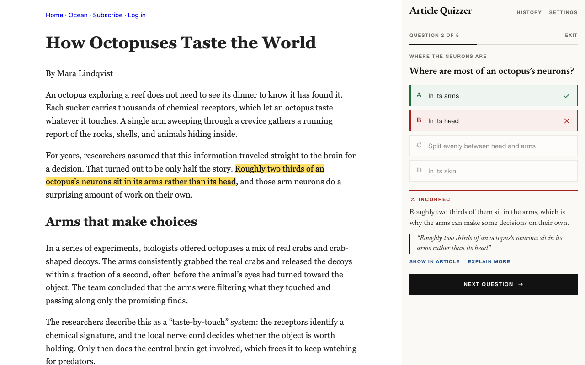

# article-quizzer

A Chrome extension that quizzes you on the article you're reading, so you actually remember it.

A quick project based on an idea I saw on the internet that I wanted to make for my own. More for the purpose of retaining article information than making a great coding project.



Click the toolbar icon on an article (or a PDF) and a side panel writes you a quiz with Google's Gemini. Every answer comes with an explanation and the passage it's based on, and **Show in article** highlights that passage on the page. Your quizzes are saved and come back when they're due for review.

## What it does

- Writes multiple-choice and short-answer questions about the main ideas, not trivia.
- Explains every answer and quotes the passage it came from. **Show in article** highlights that passage on the page, and **Explain more** asks Gemini for a fuller explanation (only when you click it).
- Grades written answers as correct, partially correct, or incorrect, and says what you missed. If grading fails (offline, rate limited), you can compare with the model answer and grade yourself.
- Has three levels: Recall, Comprehension, and Analysis.
- Works on PDFs, and on selected text (right-click → *Create a quiz from the selected text*).
- Lets you retake the questions you missed, or get new ones.
- Saves every quiz. Reopening an article offers your saved quiz first, which is instant because Gemini doesn't have to write new questions.
- Keeps simple stats: your day streak, average score, and articles quizzed this month.
- Brings quizzes back for review: the next day after a weak score, then after 3, 7, 16, 35, and 90 days as you keep scoring well.
- Runs review sessions that mix saved questions from every quiz that's due, since switching between topics makes things stick better than reviewing one article at a time.
- Has keyboard shortcuts: <kbd>1</kbd>–<kbd>4</kbd> or <kbd>A</kbd>–<kbd>D</kbd> to answer, <kbd>Enter</kbd> for the next question, <kbd>⌘/Ctrl</kbd>+<kbd>Enter</kbd> to submit a written answer, and <kbd>Alt</kbd>+<kbd>Shift</kbd>+<kbd>Q</kbd> to open the panel.

## Install

The extension isn't in the Chrome Web Store (yet), so load it in developer mode:

1. Download this repo (or `git clone` it).
2. Go to `chrome://extensions` and turn on **Developer mode** (top right).
3. Click **Load unpacked** and choose the **`extension`** folder inside the repo.
4. The settings page opens. Get a free API key from [Google AI Studio](https://aistudio.google.com/apikey) and paste it in.
5. Pin the extension: click the puzzle-piece icon in the toolbar, then the pin next to Article Quizzer.

## Using it

1. Open an article.
2. Click the Article Quizzer icon (or press <kbd>Alt</kbd>+<kbd>Shift</kbd>+<kbd>Q</kbd>, or right-click → *Create a quiz from this page*).
3. Pick the number of questions, the format, and the level, then select **Begin quiz**.

The extension reads a page only when you invoke it there. If you move to a different page in the same tab, the panel asks you to click the icon again instead of reading the new page itself, and keeps any quiz in progress.

## Why Gemini

Gemini has a free tier that needs no credit card, a context window big enough for whole articles and PDFs, and it can be held to a JSON schema, so quizzes come back in a consistent shape.

The default model is `gemini-3.8-flash`. In settings you can switch to `gemini-3.5-flash-lite` (faster, with higher free-tier limits) or enter any other Gemini model ID. If the chosen model is overloaded, the extension retries and then switches to the other one for that request. If you hit the free tier's rate limit, wait a minute or switch to Flash-Lite.

## Privacy

There's no server, no account, and no tracking. Requests go straight from your browser to Google's Gemini API using your key: the article when you start a quiz, your written answers (with the question and its quoted passage) when they're graded, and the part of the article around an answer when you click **Explain more**. Your key, settings, and quiz history stay in your browser. On Gemini's free tier, Google may use what you send to improve its products, so don't quiz yourself on confidential documents with a free key. Details are in [PRIVACY.md](PRIVACY.md).

## Development

No build step: the `extension/` folder is the extension. After editing, click the reload icon on the extension's card in `chrome://extensions`, then reopen the panel.

```
extension/
  manifest.json
  background.js      opens a side panel bound to the tab you clicked on
  sidepanel.*        the quiz UI
  options.*          settings page (opens on install)
  styles.css         shared styles, light and dark
  lib/
    gemini.js        Gemini API client (JSON-schema output, friendly errors)
    quiz.js          prompts, schemas, cleanup of model output, grading
    page.js          reads the article (Readability) and highlights passages
    storage.js       settings, history, spaced-review schedule
    dom.js           tiny DOM helpers (text only, never innerHTML)
  vendor/            Mozilla Readability 0.6.0 (Apache-2.0)
  fonts/             Newsreader typeface (SIL Open Font License)
tests/               unit tests, browser test, sample article
scripts/             packaging, screenshots, live API check
store/               screenshots and promo tile for the Web Store
```

```bash
npm install
```

| Command | What it does |
| --- | --- |
| `npm test` | Unit tests (Node's built-in runner, no browser). |
| `npm run test:e2e` | Loads the extension into Chrome for Testing and runs a full quiz against a sample article, with Gemini mocked. |
| `GEMINI_API_KEY=… npm run check:live` | Sends the sample article to the real Gemini API and prints the quiz. |
| `npm run screenshots` | Regenerates the images in `store/`. |
| `npm run package` | Zips `extension/` into `dist/` for the Chrome Web Store. |
| `npm run format` | Formats everything with Prettier. |

## Publishing

See [docs/publishing.md](docs/publishing.md) for a step-by-step Chrome Web Store guide, including listing text and the permission justifications the review form asks for.

## Credits

Article extraction uses [Mozilla Readability](https://github.com/mozilla/readability) (Apache-2.0). Type is set in [Newsreader](https://github.com/productiontype/Newsreader) by Production Type (SIL Open Font License). Everything else is MIT licensed; see [LICENSE](LICENSE).
